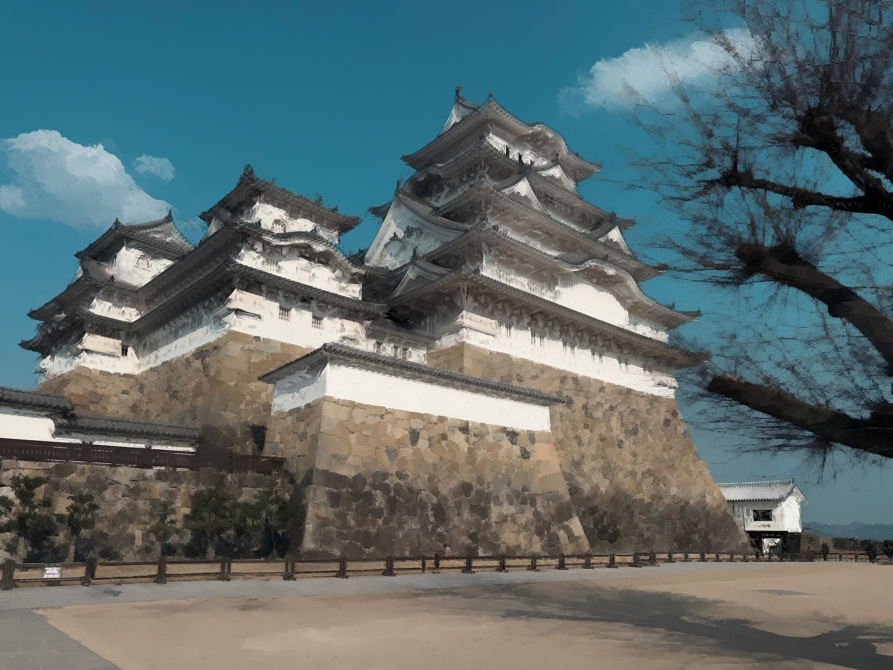
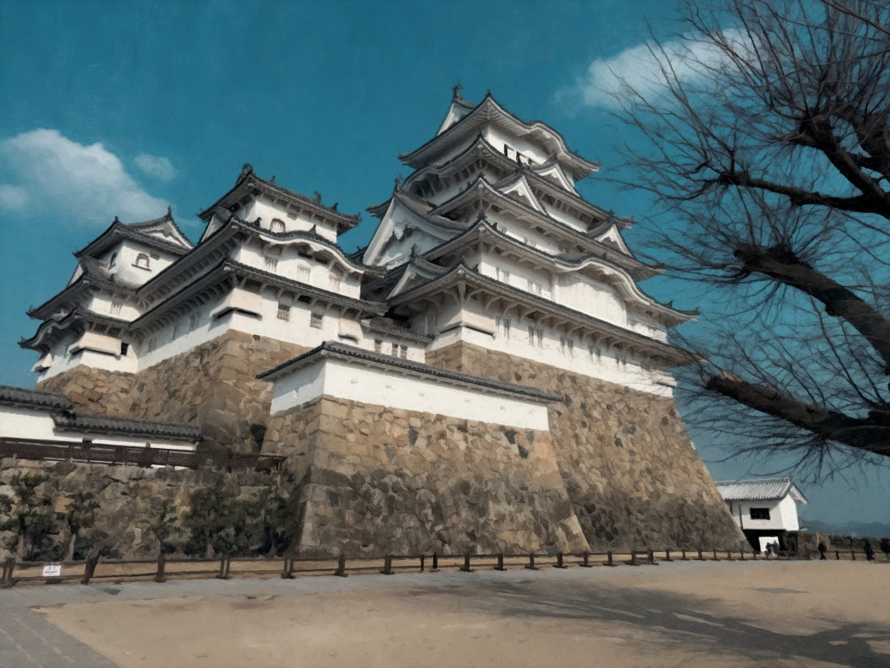
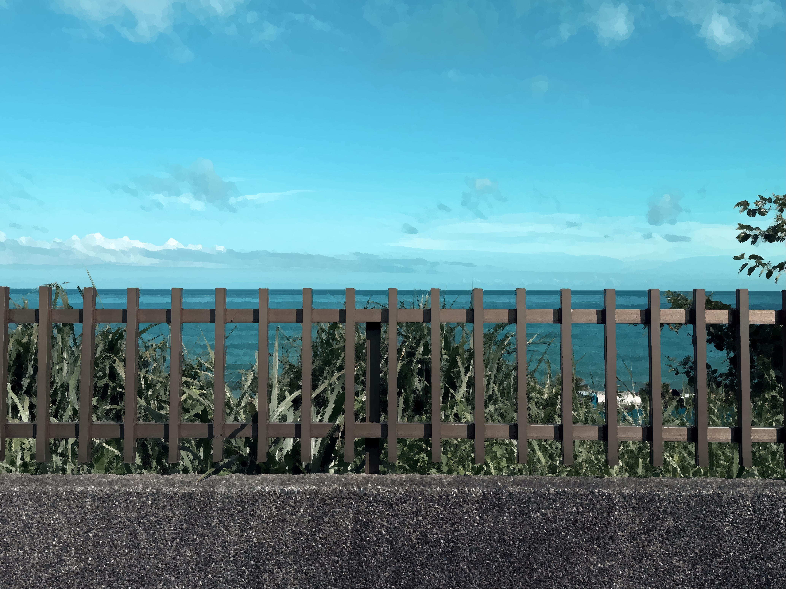
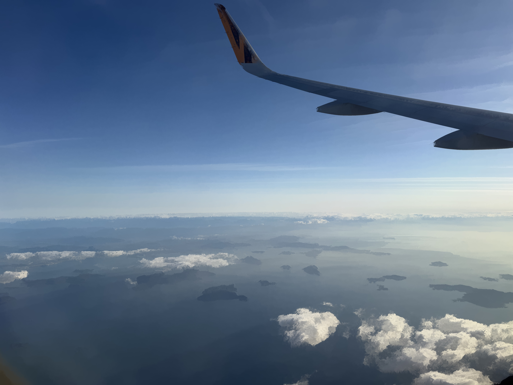
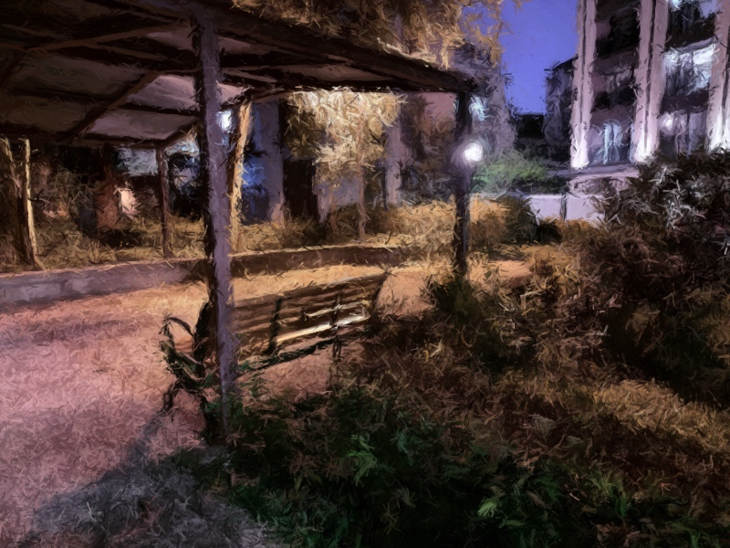
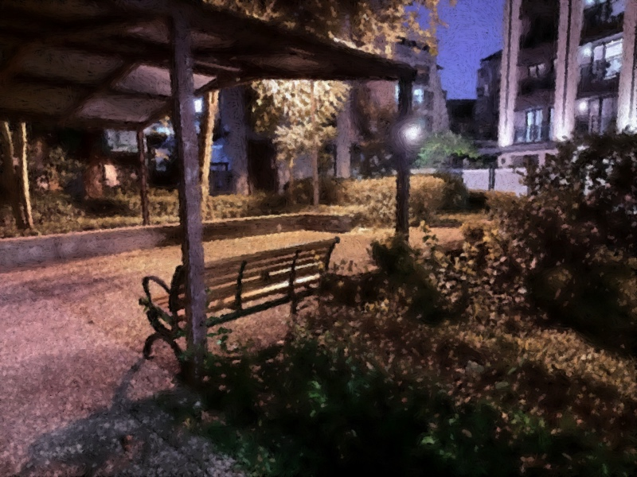

# Oil Painting Effect: Kuwahara and Hertzmann methods

本專案實作了非真實感繪製（Non-Photorealistic Rendering, NPR）中的兩種經典油畫風格化演算法：**異向性桑原濾波器（Anisotropic Kuwahara Filter）** 與 **基於筆觸的多尺度繪製演算法（Hertzmann Painterly Rendering Algorithm）**。

專案以純前端技術（WebGL / GLSL 著色器與 HTML5 Canvas 2D）打造，使用者可直接透過瀏覽器載入任意圖片，即時調整參數並產出風格獨特的數位油畫作品。

---

## 成果展示

### 1. 兩大演算法成品對比

<table>
  <tr>
    <th width="50%" align="center">異向性桑原濾波器 (Anisotropic Kuwahara)</th>
    <th width="50%" align="center">Hertzmann 筆觸演算法 (Painterly Rendering)</th>
  </tr>
  <tr>
    <td width="50%"></td>
    <td width="50%"></td>
  </tr>
  <tr>
    <td align="center"><em>特點：邊緣銳利平滑、流暢方向性、厚塗浮雕立體感</em></td>
    <td align="center"><em>特點：多尺度樣條曲線筆觸、隨機毛刷質感、手繪層次感</em></td>
  </tr>
</table>

### 2. 演算法細節與風格比較

<table>
  <tr>
    <th width="50%" align="center">異向性效果比較 (Anisotropy)</th>
    <th width="50%" align="center">厚塗效果比較 (Impasto)</th>
  </tr>
  <tr>
    <td width="50%"></td>
    <td width="50%"></td>
  </tr>
  <tr>
    <td align="center"><em>利用結構張量引導筆刷沿物體邊緣切線流動</em></td>
    <td align="center"><em>以亮度梯度法向量計算表面光照，重現油彩立體厚度</em></td>
  </tr>
</table>

<table>
  <tr>
    <th width="50%" align="center">表現主義風格 (Expressionism)</th>
    <th width="50%" align="center">點描派風格 (Pointillism)</th>
  </tr>
  <tr>
    <td width="50%"></td>
    <td width="50%"></td>
  </tr>
  <tr>
    <td align="center"><em>降低曲率過濾器保留慣性，筆觸狂放奔放</em></td>
    <td align="center"><em>縮短筆劃長度並提高色彩容忍門檻，形成色點堆疊</em></td>
  </tr>
</table>

---

## 核心演算法與特色

### 1. 異向性桑原濾波器 (Anisotropic Kuwahara Filter)
- **實作技術**：WebGL + GLSL 著色器，利用 GPU 平行運算達到**即時（Real-time）**濾波。
- **結構張量（Structure Tensor）**：分析局部梯度特徵值與特徵向量，計算出邊緣切線角度與異向性強度，使筆刷流向順應物體輪廓。
- **橢圓形取樣扇區**：取代傳統方形象限取樣，尋找色彩變異數最小的區域進行平滑，在保留銳利邊緣的同時抹平內部雜訊。
- **厚塗浮雕後處理（Impasto Effect）**：將色彩亮度視為顏料厚度，透過 GLSL 偏導數函數（`dFdx` / `dFdy`）計算表面法向量，模擬光照下的顏料凹凸陰影與高光。

### 2. Hertzmann 筆觸演算法 (Hertzmann Painterly Rendering)
- **實作技術**：HTML5 Canvas 2D + JavaScript，以**筆觸為基礎（Stroke-based）**模擬人類畫家創作流程。
- **多尺度分層繪製（Coarse-to-fine）**：使用由大到小的筆刷分層迭代。底層大筆刷快速鋪色打底，表層小筆刷修飾局部細節。
- **樣條曲線筆觸（Spline Strokes）**：沿著影像亮度梯度的法線方向（等高線）生長控制點，搭配 IIR 曲率濾波器控制畫筆柔軟度與走勢。
- **真實毛刷質感**：在筆刷半徑範圍內隨機生成多條半透明微小偏移細線，打破數位繪圖的機械感。

---

## 使用方法

直接使用任意現代網頁瀏覽器（Chrome, Edge, Safari, Firefox）開啟以下檔案：
   - `Kuwahara Filter.html`：即時 GPU 異向性桑原濾波器。
   - `Hertzmann Alogrithm.html`：具備完整互動控制面板的筆觸渲染器。
   - `Hertzmann Algorithm HQ.html`：預設高品質參數的筆觸渲染器。

---

## 參考文獻

1. Hertzmann, A. (1998). *Painterly rendering with curved brush strokes of multiple sizes*. In Proceedings of the 25th annual conference on Computer graphics and interactive techniques (SIGGRAPH '98), pp. 453-460.
2. Kuwahara, M., Hachimura, K., Eiho, S., & Kinoshita, M. (1976). *Processing of RI-angiocardiographic images*. Digital processing of biomedical images, 187-202.
3. Foley, J., van Dam, A., Feiner, S., & Hughes, J. (1995). *Computer Graphics: Principles and Practice*. Addison-Wesley.
